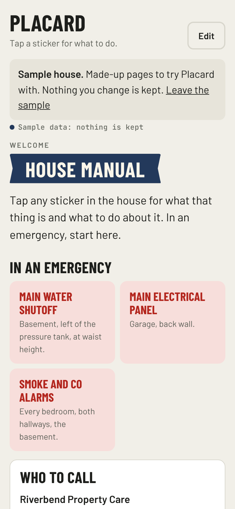
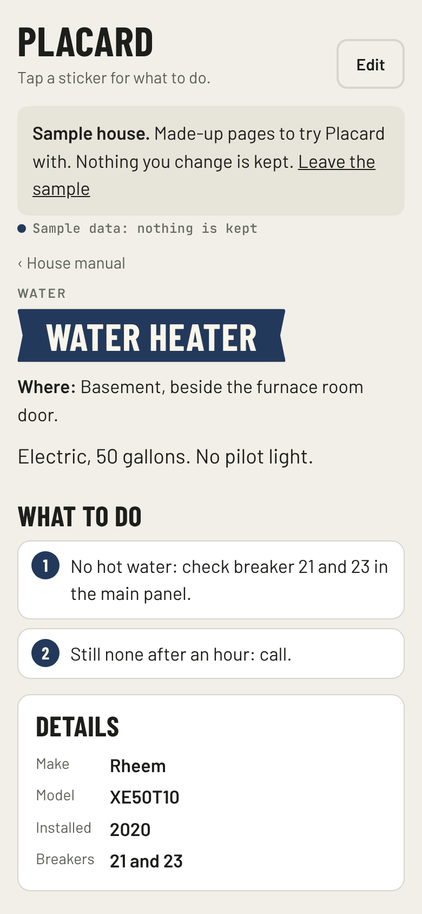

# Placard

**Use it: [placard.junkdrawer.works](https://placard.junkdrawer.works/)** (writing stickers needs Chrome on an Android phone)

**A house manual on NFC stickers: tap the sticker on the water heater, the breaker panel or the shutoff and get what it is and what to do, with no app and no sign-in.** Made for a rented house, where the person tapping isn't the owner. Tenants and repair people get plain pages that work on any phone, iPhone included. The owner edits the pages from the same site, writes and locks the stickers, prints QR backups, and gets an email when someone reports a problem.

<p align="center">
  
  
</p>

## How it works

- **Public pages.** Anyone can read the manual. It comes from the owner's Switchboard ledger with no key, and the phone keeps a copy for next time.
- **Locked stickers.** Each sticker can be made read-only after it's checked, so nobody can rewrite it to point somewhere else. Lock reads the sticker first and locks it only if it holds that page's link, and Write asks before writing over a sticker that already opens something. Another sticker written for a locked page asks whether it replaces the one on the wall or is a spare to keep: a spare leaves the page locked, with a line saying when it was written and locked. Its link goes through Switchboard, so the page can still move.
- **A page taken out.** Deleting a page whose sticker is written or locked asks where its sticker should go instead (the front page unless you pick another). A small record in the manual does the sending, so it works on tenants' phones with no signal and needs nothing changed in Switchboard; the Edit screen lists it under Stickers sent to another page, where it can be sent elsewhere or stopped.
- **Photos.** A page can show a photo under Where (the shutoff behind the stair, the panel), larger when tapped. Each is a file in this repo's `photos` folder, named on its page: about 1200 px wide and under 200 KB. They're public like the pages, so nothing showing the house number or the street. A tenant's phone keeps every page's photo once it has opened the manual with a signal, so a picture opens with none.
- **When things were last done.** A page can carry a regular job, every N months and when it was Last done: tenants read "Last filter change: Nov 3, 2026. Every 3 months.", the owner's Edit list says **due** once it's past, and marking a Service visit report handled offers to set Last done to its day.
- **Other numbers.** Besides the house contact, the septic company, the power company's outage line or a backup, each with when to call, under Who to call on the front page. A page can show one of them on its card (the septic page, the septic company), with the house contact under it.
- **911 first for a fire.** "Fire, smoke or a CO alarm: get everyone out, then call 911." heads In an emergency on the front page and the smoke and CO alarm page (any emergency page under Safety), whose report form then says to call 911 instead of the house contact.
- **Reports.** A form on every page, the front page included, keeps the note in the ledger and emails the owner: at most 30 reports an hour, and 20 emails a day (past that the note is still kept, and the tenant is told to call if it's urgent). The same words from the same page again within the hour are kept but not emailed twice. Reports go to the address in the ledger sheet's About tab (B3); more than one, separated with commas, reaches the property manager too. What's typed stays on the phone until it sends, and a failed send offers a text message to the contact instead. On the owner's Reports screen the same words from one page on one day are one card ("Sent 3 times, 2:19-2:31 am") with one Mark handled; the same words after it's handled are a new card. A phone number or email address left in a report has Call and Text, or Email, each with the person's name when a card holds more than one person's.
- **QR backups.** A printable sheet of QR codes, one per system, for phones with NFC switched off.
- **The front door.** A sticker and QR card for the whole manual (`tag.junkdrawer.works/h/house`), written and locked from Edit, for inside the front door.
- **Sample house.** Open it with `?demo` for a made-up house to try everything on.
- **Switchboard.** Records live in your Switchboard ledger (a Google Sheet you own), so they follow you between the phone and the laptop. Connect from [tag.junkdrawer.works](https://tag.junkdrawer.works/).

## Running it

It's a static site: plain HTML, CSS and JavaScript, with no build step.

```sh
npx http-server -p 8080 -c-1 .   # then open http://localhost:8080 (add ?demo for sample data)
npm test                         # unit tests, then the page in Chromium with a pretend NFC reader
node tools/make-icons.mjs        # PNG icons from icon.svg
```

GitHub Pages serves it from `main`, `/ (root)`, at its own address (`CNAME`).

### Files

- `js/app.js`: tenant pages and owner tools.
- `js/starter.js`: the usual list of systems, the sample house, and the text helpers.
- `js/config.js`: the ledger's public address, so tenants' phones can read it.
- `photos/`: the pages' photos (`sample-shutoff.jpg` is a drawing, for the sample house).
- `js/kit/`, `css/kit.css`: the tag apps' shared kit (ledger client, Web NFC, small UI helpers).
- `fonts/`: Barlow, Barlow Condensed and JetBrains Mono (SIL Open Font License), served from here so nothing loads from elsewhere.
- `test/e2e.mjs`, `test/app-checks.mjs`: the page in Chromium, offline included.

